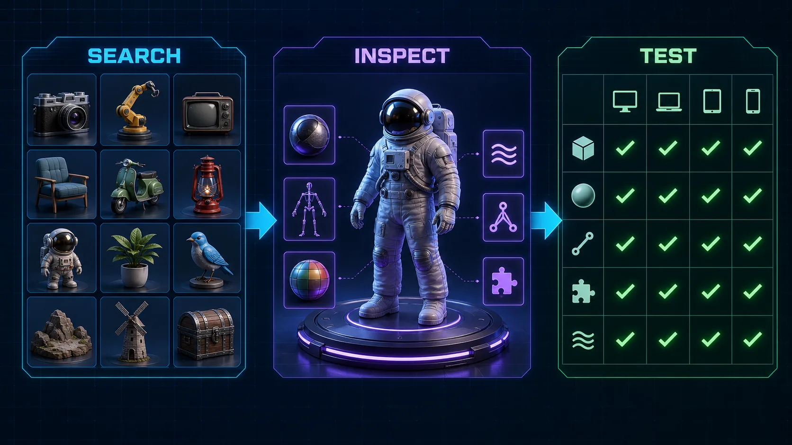

# DCC-MCP glTF Sample Assets



Khronos glTF Sample Assets discovery and download tools for DCC-MCP.

This skill uses the public GitHub repository tree and raw file URLs. It is for
testing, validation, examples, and glTF feature coverage. It does not import
files into a DCC scene.

## Install

```bash
dcc-mcp-cli marketplace add dcc-mcp/dcc-asset-gltf-sample-assets
dcc-mcp-cli marketplace install dcc-asset-gltf-sample-assets
```

## Tools

- `search_gltf_sample_assets`
- `list_gltf_sample_files`
- `download_gltf_sample_file`

## License Notes

This wrapper is MIT licensed. Khronos sample assets have per-asset licenses and
credits in each model directory. Keep the downloaded model's `README.md` or
`LICENSE.md` with any copied assets.
