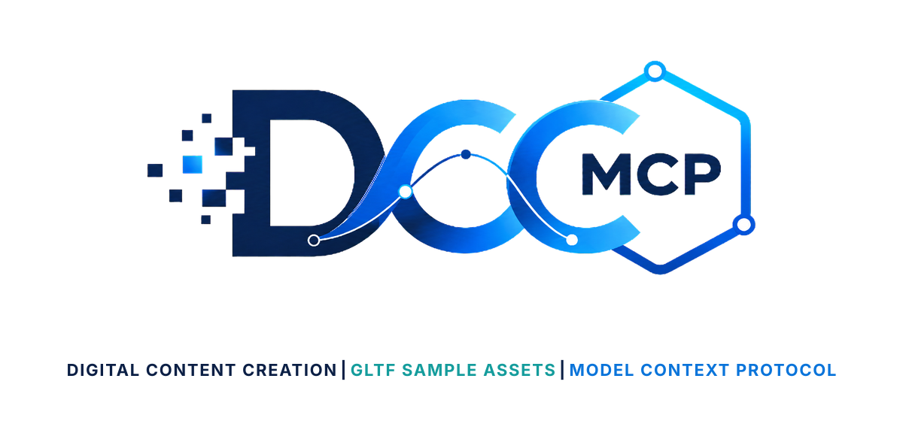

# DCC-MCP glTF Sample Assets

<p align="center">
  
</p>

## Agent workflow

AI agents should use installed package skills through the shared gateway. IDE
users may continue to use the MCP endpoint.

```bash
dcc-mcp-cli dcc-types
dcc-mcp-cli list
dcc-mcp-cli search --query "<task>" --dcc-type <host>
dcc-mcp-cli describe <tool-slug>
dcc-mcp-cli call <tool-slug> --json '{"key":"value"}'
```

If the package skill is not active, call
`dcc-mcp-cli load-skill <skill-name> --dcc-type <host>`. After the task,
query `dcc-mcp-cli stats --range 24h --session-id <task-id>` and pass only
bounded evidence to the `review_skill_improvement` prompt from
`dcc-mcp-skills-creator`.


Khronos glTF Sample Assets discovery and download tools for DCC-MCP.

This skill uses the public GitHub repository tree and raw file URLs. It is for
testing, validation, examples, and glTF feature coverage. It does not import
files into a DCC scene.

## Install

```bash
dcc-mcp-cli marketplace add dcc-mcp/dcc-asset-gltf-sample-assets
dcc-mcp-cli marketplace install dcc-asset-gltf-sample-assets
```

## Tools

- `search_gltf_sample_assets`
- `list_gltf_sample_files`
- `download_gltf_sample_file`

## License Notes

This wrapper is MIT licensed. Khronos sample assets have per-asset licenses and
credits in each model directory. Keep the downloaded model's `README.md` or
`LICENSE.md` with any copied assets.
